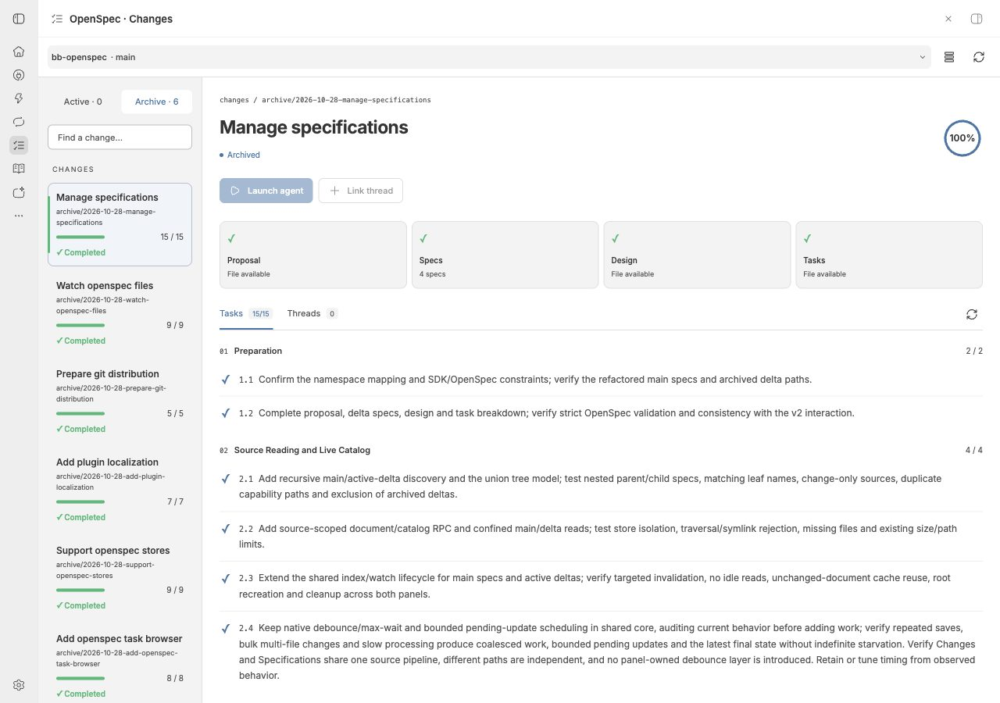
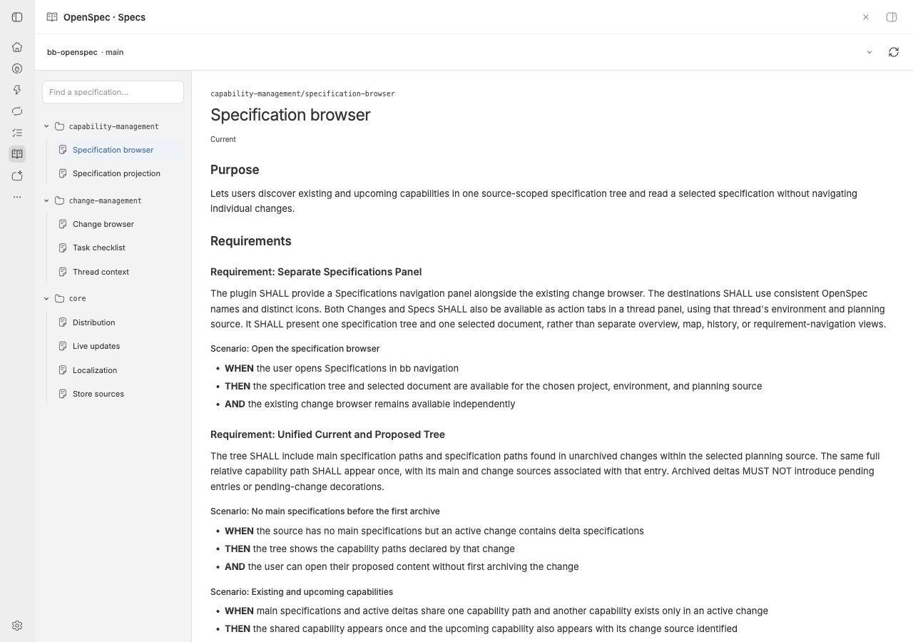
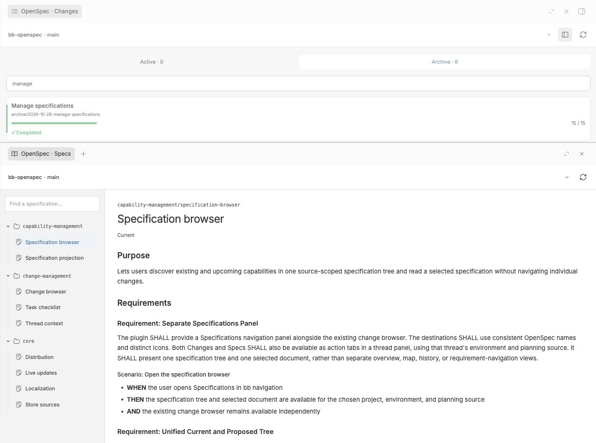

# OpenSpec for bb

English · [Русский](README.ru.md)

Track OpenSpec changes and task progress in [bb](https://getbb.app/), read specifications, and launch or link agent threads. Tasks stay in your repository.

## Features

- Active and archived changes, search, project and environment selection.
- A separate **OpenSpec · Specs** panel: a searchable namespace tree combining main specs and active change deltas, including capabilities before their first archive.
- Read complete specifications in **Current / Proposed / Compare**, with Git-style status colors, explicit change selection and visible unresolved operations.
- Markdown previews for proposals, specifications, designs and tasks, with access to the source files in bb.
- Read-only `✓` / `○` checklists and progress from `tasks.md`; agents update the files.
- Compact cards or a list with details, including linked thread status and an animated working indicator.
- Changes with a working agent first, followed by recently modified artifacts.
- Launch threads to explore, implement or verify a change, with an editable English prompt and bb's provider, model and permission controls. The new thread is linked automatically.
- Link existing threads manually or through plugin RPC. Available in the navigation panel and inside a thread.
- Local OpenSpec directories and registered OpenSpec stores (beta).
- Native file watching on the project machine, incremental task updates and reconnect recovery.
- English and Russian UI, with automatic browser-language selection.

## Screenshots

| Changes · task progress | Specs · specification tree |
| --- | --- |
|  |  |

Changes and Specs open together in bb:



## Requirements

- bb 0.47 or later with Plugin SDK 0.6.79 or later. Verified locally with bb 0.47.1 / SDK 0.6.79 on macOS.
- A ready bb environment with a standard OpenSpec directory or a registered store.
- OpenSpec CLI on the environment machine for store discovery (`context --json`, `store list --json`; verified with OpenSpec 1.10.0). Local planning files work without it.
- An agent provider configured in bb to run agents. The plugin itself needs no external account or service.

## Install from source

Node.js 22.19+ (22.x), 24.x or 26.x and npm are needed for development. Git installs use bb's bundled tools to install production dependencies and build the plugin.

```sh
npm ci --include=dev
npm run build
bb plugin install .
```

Open **OpenSpec · Changes** or **OpenSpec · Specs** in bb navigation. To keep either view beside a conversation, open the thread's right panel, click **+**, and choose **OpenSpec · Changes** or **OpenSpec · Specs** under **Actions**. bb remembers opened tabs separately for each thread. Click the project name in the header to select its environment and planning source. Use the view icon to switch between compact cards and details.

Install the current main branch from Git:

```sh
bb plugin install 'git:https://github.com/khaale/bb-openspec.git@main'
```

Tagged releases and version ranges are described in [release preparation](docs/RELEASING.md). A `v0.5.0` release tag has not been created by this update.

## Specifications

**OpenSpec · Specs** shows `openspec/specs/**/spec.md` together with specifications introduced or modified by active changes. Folders follow full relative paths; a parent may have its own `spec.md` and children. Archived deltas are excluded from pending work.

Select a specification to read the complete document. **Current** reads the main spec; **Proposed** applies one identified change; **Compare** shows before/after requirement blocks, including removals and renames. Choose a change when several affect the same capability. A new capability opens Proposed with Current unavailable. Green **A** indicates an addition, amber **M** a modification. Unsupported or conflicting operations expose readable sources and diagnostics instead of a partial proposed result. Projection is a read-only preview; it does not perform CLI validation, sync or archive.

In narrow panels, select a tree entry to read it and use the back button to return. Both navigation panels share user-selected project, environment and planning source within the browser; thread panels keep their own environment and binding.

## Agent threads

**Launch agent** starts a visible thread in the selected code environment and links it to the change. It uses the existing checkout. **Link thread** assigns a thread from that environment without starting it or sending a message. A thread has one current binding; a change can have several threads. Bindings persist in bb plugin metadata and include the planning source.

Manager agents can call `launch`, `attach`, `changes` and `threadChoices` using `bb plugin rpc call`. See the [plugin instructions](skills/openspec-work/SKILL.md) for request formats.

Task checkboxes are read-only. “Completed” means every task in `tasks.md` is checked; validation and archiving are separate operations.

## Language

In the plugin settings, **Language** offers **Automatic**, **English** and **Russian**. Automatic uses supported languages from the current browser's preferences, with English as fallback. A manual selection applies to all open plugin panels without reload.

```sh
bb plugin config openspec set language ru
bb plugin config openspec set language en
bb plugin config openspec set language auto
```

UI labels, tooltips, counters and the plugin's own errors are translated. OpenSpec content, names and external tool errors retain their original text. Native bb controls follow bb's own language behavior. Settings labels are English.

New launch prompts and agent instructions are always English and require following project instructions, including the language of artifacts. Switching the UI language preserves the selected change and edited prompt.

### Add a localization

1. Create `src/messages/<locale>.ts` using `ru.ts` as an example. Use `Record<keyof typeof en, string>` to check the keys against the English catalog, and preserve placeholders such as `{name}` and `{count}`.
2. Import and register the catalog in `CATALOGS` in `src/messages/index.ts`; add its English name to `LOCALE_LABELS`. Settings and browser-language resolution derive from that registry.
3. Translate `task.*` and `spec.*`, then check number formatting and long labels in narrow panels. `Intl` selects plural forms. Currently `one`, `few`, `many` and `other` are supported; a language using `zero` or `two` requires extending `src/i18n.ts` and the catalogs.
4. Run `npm run check`, rebuild and reload the plugin. Tests check all registered catalogs for matching keys and interpolation parameters. No additional localization dependency is needed.

## OpenSpec stores (beta)

Expand the header to choose **OpenSpec source**: **Automatic**, **Local**, or a registered store. Automatic follows OpenSpec discovery; Local explicitly uses the environment's own planning files. Store selection changes the planning source while preserving the agent's code environment. Launch prompts include both paths and the required `--store` flag.

Configure stores with the [OpenSpec CLI](https://openspec.dev/docs/stores). The plugin reads registration on the selected environment's machine; it does not register, clone, pull or push stores. Agent access to an external planning path depends on its bb permissions.

Click refresh after changing registration, `store:` configuration or `defaultStore`. Discovery is cached; files in the selected planning root update through native watching. References remain read-only CLI workflow context. Custom workflow schemas, upstream spec browsing and Worksets are not interpreted.

## Updates and limits

Initial loading indexes the planning directory and reads task files. The Specs catalog caches active-delta summaries; full main/delta documents load on demand in a bounded cache. Saving a known `tasks.md` rereads that file; structural changes rescan the file list. Documents load on demand. Both panels share a watcher and update queue per path, with native 120 ms debounce, 700 ms maximum batch wait and one coalesced pending batch during slow processing. These timings bound native batching, not end-to-end processing. The watcher is released after the last subscription closes. Reconnect triggers a rescan; a watch error can be retried with refresh. Thread status uses bb events.

Standard active and archived change directories are supported, including `proposal.md`, `design.md`, `tasks.md` and `specs/**/spec.md`. Limits per planning source: 200 changes, 4000 files/directories and 512 KiB per document. Thread discovery considers up to 200 recent visible threads in an environment.

## Development

```sh
npm ci --include=dev
npm run check
npm run verify:git-build
npm run test:specifications # requires OpenSpec CLI; isolated archive/projection comparison
npm run test:stores # requires OpenSpec CLI; uses isolated temporary stores
```

`verify:git-build` copies the working source to a temporary directory, installs with `--omit=dev --omit=optional --ignore-scripts`, builds all entries and checks their identity metadata. It does not install or replace a plugin. The temporary copy is removed afterwards. The build may download bb's toolchain on first use.

`bb-app` is pinned as a development dependency for CI and builds without a running bb server. CI runs checks and the production dependency build; it has no release or publishing steps. Store CLI integration is a separate local check.

For live development, run `bb plugin dev`. After a one-off build, use `bb plugin reload openspec` to reload an installed local plugin.

| Files | Purpose |
| --- | --- |
| `app.tsx`, `style.css` | Navigation and thread panel UI |
| `server.ts`, `src/contract.ts` | RPC, bindings and thread launch |
| `host.ts`, `src/file-index.ts`, `src/watch-pool.ts` | Host file index and native watchers |
| `src/source-resolver.ts` | CLI store discovery and source cache |
| `src/live-updates.ts` | Query invalidation and subscription lifecycle |
| `src/specification-*.ts`, `src/specifications-panel.tsx` | Specification catalog, projection and reader |
| `src/model.ts` | Task parser and shared model |
| `src/messages/`, `src/i18n*.ts*` | Locale registry, catalogs and UI translation |
| `openspec/` | Plugin development specifications and changes |

Development follows OpenSpec. Proposals, designs, specifications and tasks are maintained in English, as required by `openspec/config.yaml`. Current requirements live in [openspec/specs](openspec/specs/); completed changes are in [the archive](openspec/changes/archive/). Archived work covers the [task browser](openspec/changes/archive/2026-10-28-add-openspec-task-browser/), [watcher](openspec/changes/archive/2026-10-28-watch-openspec-files/), [stores](openspec/changes/archive/2026-10-28-support-openspec-stores/), [localization](openspec/changes/archive/2026-10-28-add-plugin-localization/) and [distribution preparation](openspec/changes/archive/2026-10-28-prepare-git-distribution/). The [specification browser](openspec/changes/archive/2026-10-28-manage-specifications/) is also archived, with its requirements synced into the main specs. Design mockups under `docs/mockups/` record earlier iterations.

Verification reports: [specifications](docs/research/specifications-verification.md), [watcher](docs/research/watcher-verification.md), [stores](docs/research/stores-verification.md), [localization](docs/research/localization-verification.md). See [CHANGELOG.md](CHANGELOG.md) for version history and [docs/RELEASING.md](docs/RELEASING.md) for the Git release checklist and future Community submission requirements.

## License

[MIT](LICENSE).
