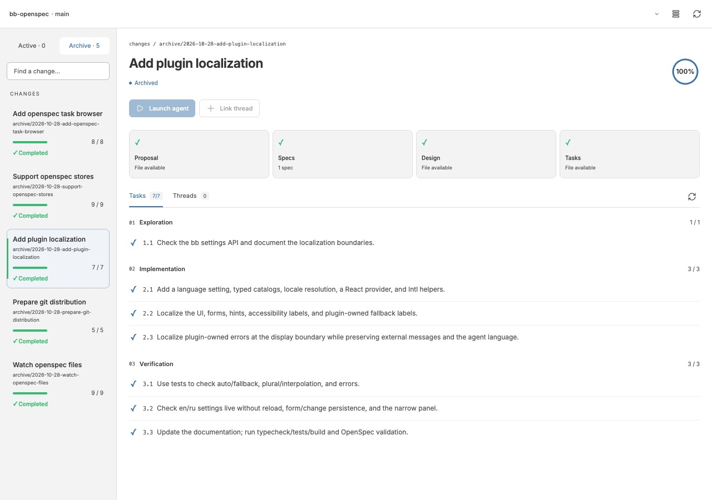
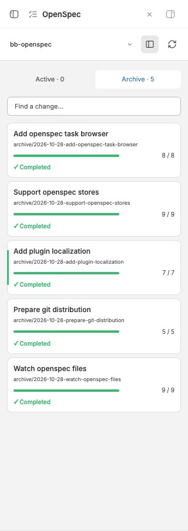

# OpenSpec for bb

[English](README.md) · Русский

Плагин bb для работы с изменениями OpenSpec: просмотр спецификаций и прогресса задач, запуск агентов и привязка тредов. Источник задач — файлы репозитория; отдельная база задач не создаётся.

## Возможности

- Активные и архивные changes, поиск, выбор проекта и готового окружения.
- Просмотр Proposal, Specs, Design и Tasks в Markdown, открытие исходных файлов в bb.
- Чеклист только для чтения: статусы `✓` / `○` и прогресс вычисляются из `tasks.md`, файлы обновляет агент.
- Компактный список карточек или список с деталями. Карточки показывают выполнение задач и состояние связанных тредов; работающий агент отмечается медленным spinner.
- Свёрнутый выбор проекта, окружения и источника, подсказки у иконок и адаптация к узким панелям.
- Запуск нового треда для проработки, реализации или проверки change с редактируемым первым сообщением и стандартными настройками провайдера, модели и разрешений bb.
- Ручная или программная привязка существующего треда. Панель OpenSpec также доступна внутри треда.
- Локальные источники и зарегистрированные OpenSpec stores (beta), включая store-only и store-optional проекты.
- Сначала changes с работающим агентом, затем свежие по времени изменения артефактов.
- Обновление по native watcher на машине проекта и событиям bb, без периодического перечитывания файлов.

## Скриншоты

| Полный вид | Узкая панель |
| --- | --- |
|  |  |

## Требования

- bb >= 0.47 с Plugin SDK >= 0.6.79. Разработка и проверки выполняются с SDK 0.6.79.
- Node.js и npm для установки зависимостей и сборки.
- Готовое окружение bb с обычным каталогом `openspec/`.

Для обычных локальных changes CLI OpenSpec не нужен. Для stores и автоматического разрешения store-only/defaultStore нужен CLI с командами `context --json` и `store list --json`, доступный в PATH машины окружения (проверено с OpenSpec 1.10.0). Для ведения спецификаций и их проверки в процессе разработки используется установленный `openspec` CLI.

## Установка из исходников

В корне проекта выполните:

```sh
npm ci --include=dev
npm run build
bb plugin install .
```

Откройте **OpenSpec** в навигации bb. Нажмите название проекта в шапке, чтобы выбрать проект и окружение. В меню вкладок панели треда также доступно действие **OpenSpec**.

## Работа с агентами

Кнопка **Запустить агента** создаёт видимый тред в выбранном окружении и автоматически связывает его с change. Агент работает в том же checkout; новое окружение или worktree плагин не создаёт.

**Привязать тред** назначает существующий тред из того же окружения без отправки сообщения и запуска работы. У треда одна текущая привязка: повторное назначение заменяет прежнюю. У change может быть несколько связанных тредов. Связи хранятся в plugin metadata bb.

Агент-менеджер может использовать RPC `launch`, `attach`, `changes` и `threadChoices` через `bb plugin rpc call`. Форматы запросов и правила работы описаны в [инструкции плагина](skills/openspec-work/SKILL.md).

## Язык интерфейса

В настройках плагина bb доступен **Language**: **Automatic**, **English**, **Russian**. Auto выбирает поддерживаемый язык из предпочтений текущего браузера; для остальных языков используется английский. Явный выбор хранится в настройках плагина и применяется ко всем открытым панелям без reload.

```sh
bb plugin config openspec set language ru
bb plugin config openspec set language en
bb plugin config openspec set language auto
```

Переводятся собственные подписи, подсказки, статусы, счётчики и сообщения об ошибках. Содержимое OpenSpec, имена проектов/тредов/stores и внешние сообщения CLI не переводятся. Native-компоненты bb, например выбор модели и разрешений, остаются на языке bb.

Новый стартовый prompt и служебные инструкции всегда английские и требуют следовать инструкциям проекта, включая язык артефактов. Смена UI locale сохраняет уже отредактированный prompt и выбранный change. Переводы находятся в типизированных каталогах `src/messages/en.ts` и `src/messages/ru.ts`; дополнительные библиотеки локализации не используются.

### Добавление локализации

1. Создайте `src/messages/<locale>.ts` по образцу `ru.ts`. Каталог должен удовлетворять `Record<keyof typeof en, string>`: английский каталог задаёт полный набор ключей. Сохраняйте параметры сообщений, например `{name}` и `{count}`.
2. Импортируйте каталог в `src/messages/index.ts`, добавьте его в `CATALOGS`, а название языка на английском — в `LOCALE_LABELS`. Список настроек и определение языка браузера обновятся автоматически; компоненты менять не требуется.
3. Переведите формы `task.*` и `spec.*`, проверьте числа и длинные подписи в узкой панели. Числа и выбор формы используют `Intl`. Сейчас поддержаны категории `one`, `few`, `many`, `other`; для языка с `zero` или `two` нужно расширить helper в `src/i18n.ts` и соответствующие ключи.
4. Выполните `npm run typecheck`, `npm test` и `npm run build`. Тесты проверяют полноту всех зарегистрированных каталогов и совпадение параметров. После сборки выполните `bb plugin reload openspec` и выберите новый язык в настройках.

## Stores (beta)

В раскрытом выборе контекста доступен **Источник OpenSpec**:

- **Автоматически** — разрешение корня по правилам OpenSpec: локальное планирование, `store:` в config или `defaultStore` машины.
- **Локальный** — `openspec/` выбранного окружения независимо от store-настроек.
- **Store · имя** — явный выбор зарегистрированного store, эквивалентный `--store имя`.

Настройте store стандартными командами OpenSpec. Плагин читает регистрацию на машине выбранного окружения, не регистрирует stores и не выполняет clone/pull/push. [Документация OpenSpec stores](https://openspec.dev/docs/stores).

Выбор store меняет источник артефактов и задач, сохраняя кодовое окружение запуска агента. Store виден в шапке, связи с тредами учитывают источник: одинаковые имена change в разных stores независимы. В prompt передаются полный planning path, code checkout и нужный `--store`. Доступ агента к внешнему каталогу определяется настройками разрешений bb.

Разрешение корня кешируется в памяти. После изменения `store:`, `defaultStore` или регистрации нажмите обновление: плагин повторит discovery и переключит watcher. Изменения файлов уже выбранного store обновляются автоматически.

References остаются read-only контекстом стандартных workflow OpenSpec CLI; отдельного каталога upstream specs или Worksets в интерфейсе пока нет. Старые привязки без store сохраняют локальный источник.

## Обновление данных

Первая загрузка сканирует OpenSpec и читает файлы задач. При сохранении известного `tasks.md` индекс перечитывает только этот файл; структурные изменения обновляют список файлов. Содержимое документов загружается при открытии.

Открытые панели разделяют watcher одного пути; после закрытия последней подписки watcher и индекс освобождаются. Восстановление подключения выполняет rescan. При ошибке панель показывает сообщение, а кнопка обновления позволяет повторить подключение. Состояние агента обновляется через события тредов bb.

[Сравнение прямого чтения с OpenSpec CLI на praxis и lore](docs/research/openspec-watcher.md) содержит замеры и команду воспроизведения benchmark.

## Разработка

```sh
npm run check # typecheck, tests и сборка
npm run verify:git-build # чистая сборка с production-зависимостями
npm run test:stores # интеграция с CLI в изолированных временных stores
bb plugin dev
```

После сборки установленный плагин можно перезагрузить командой `bb plugin reload openspec`.

| Файлы | Назначение |
| --- | --- |
| `app.tsx`, `style.css` | Интерфейс навигации и панели треда |
| `server.ts`, `src/contract.ts` | RPC, привязки и запуск тредов |
| `host.ts`, `src/file-index.ts`, `src/watch-pool.ts` | Индекс файлов и native watcher на машине проекта |
| `src/source-resolver.ts` | Разрешение store через CLI и cache источников |
| `src/live-updates.ts` | Live queries, invalidation и lifecycle |
| `src/model.ts` | Разбор задач и общая модель |
| `tests/` | Parser, RPC, индекс и lifecycle watchers |
| `openspec/` | Спецификации и changes разработки плагина |
| `docs/` | Исследования, макеты и результаты проверки |

Разработка ведётся через OpenSpec. Proposals, designs, спецификации и tasks ведутся на английском языке; правило задано в `openspec/config.yaml`. Актуальные требования — в [openspec/specs](openspec/specs/), завершённые changes — в [архиве](openspec/changes/archive/): [первая версия браузера](openspec/changes/archive/2026-10-28-add-openspec-task-browser/), [watcher и обновление интерфейса](openspec/changes/archive/2026-10-28-watch-openspec-files/), [stores](openspec/changes/archive/2026-10-28-support-openspec-stores/) и [локализация](openspec/changes/archive/2026-10-28-add-plugin-localization/). Макеты в `docs/mockups/` отражают этап проектирования; актуальный интерфейс находится в исходниках.

Проверка спецификаций:

```sh
openspec validate --specs --strict --no-interactive
```

[Проверка локализации в версии 0.4.0](docs/research/localization-verification.md), [stores в версии 0.3.0](docs/research/stores-verification.md) и [watcher в 0.2.0](docs/research/watcher-verification.md). История изменений — в [CHANGELOG.md](CHANGELOG.md).

## Ограничения

Поддерживается стандартная структура `openspec/changes/<change>/` и `openspec/changes/archive/<date>-<change>/` с `proposal.md`, `design.md`, `tasks.md` и `specs/**/spec.md`. Пользовательские схемы workflow не интерпретируются; stores используют ту же стандартную файловую структуру.

Плагин не редактирует checklist, не архивирует changes и не выполняет проверку спецификаций из интерфейса. Метка «Выполнено» означает, что отмечены все задачи в `tasks.md`; архивирование и результаты проверок учитываются отдельно.

Ограничения на окружение: 200 changes, 4000 файлов/каталогов OpenSpec, документ до 512 КиБ. При превышении показывается ошибка. Поиск связанных тредов и выбор для привязки охватывают до 200 последних видимых тредов окружения.

## Распространение и лицензия

Лицензия [MIT](LICENSE). [Подготовка Git-релиза](docs/RELEASING.md): проверки, установка по тегам и отдельный будущий этап Community. Установка текущей ветки main:

```sh
bb plugin install 'git:https://github.com/khaale/bb-openspec.git@main'
```

Тег `v0.4.0` этим обновлением не создаётся.
